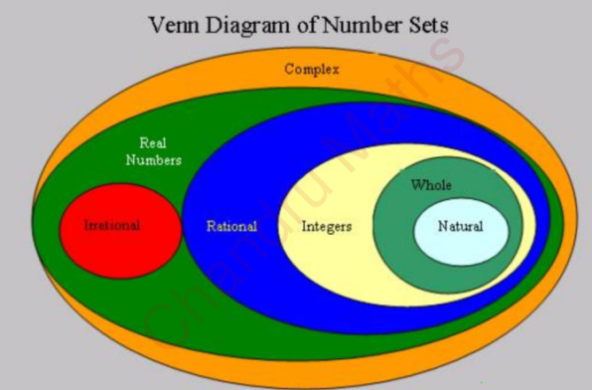
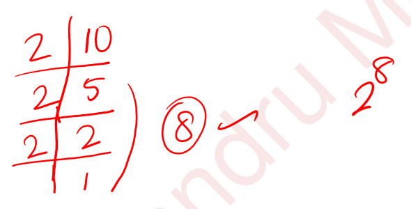
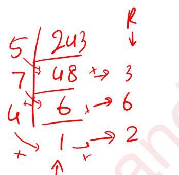

# 🔢 Number System (M01) | எண் அமைப்பு

**SSC CGL + RRB NTPC preparation · Simple English + Tamil · Learn → solve → recall**

**Main source:** [NUMBER SYSTEM.pdf — 328 pages](<Materials - Pdf/NUMBER SYSTEM.pdf>). Page references below mean the PDF viewer's page number, starting at 1.

These notes reorganise the PDF into a learning sequence. Explanations, counterexamples, corrected rules and fresh practice are added for understanding. They are **not a question-by-question answer key to all 328 pages**.

> **Remember — how to use this chapter**
>
> Read one topic. Cover the solution and try its five models. Then solve a new question without help. Reading a solution is preparation; solving independently is evidence of learning.
>
> **தமிழில்:** ஒரு பகுதியைப் படி → விடையை மறைத்துச் செய் → புதிய வினாவைத் தனியாகச் செய். பார்த்துப் புரிவதும், உதவியின்றிச் செய்வதும் ஒன்றல்ல.

---

## 🧭 1. Your learning route | கற்கும் வரிசை

This chapter covers **M01**, with small bridges from **MF1–MF3**. Full HCF/LCM belongs to **M02**, simplification to **M03**, and indices/surds to **M04** in your [Maths checklist](../../Plan/Subject-Checklists/MATHS-CHECKLIST.md).

| Pass | Study these sections | What you should be able to do |
|---|---|---|
| 🌱 Start | 2–6: language, digits, number families, odd/even, primes | Explain each word and check small examples |
| 🧱 Build | 7–9: divisibility, sums, squares | Choose a rule and explain why it applies |
| ⚙️ Apply | 10–12: last digits, factorials, zeros | Handle large expressions without expanding them |
| 🔍 Extend | 13–17: factors and remainders | Break a mixed question into smaller steps |
| 🎯 Check | 18–21: source corrections, practice, revision | Solve fresh questions and repair errors |

**First reading:** Sections 3–7 come before shortcuts. The harder models are practice targets, not a reason to skip the basics.

> **Concept map — what is a Number System question asking?**
>
> - **What kind of number?** → number families, primes, odd/even.
> - **What divides it?** → divisibility and prime factorisation.
> - **What is its last digit?** → powers and repeating cycles.
> - **How many factors or zeros?** → count prime powers.
> - **What is left after division?** → quotient and remainder.

---

## 🗣️ 2. Words and symbols | முதலில் சொற்களைப் புரிந்துகொள்

| Word / symbol | Simple meaning | தமிழில் |
|---|---|---|
| Digit | One symbol from 0 to 9 | இலக்கம் |
| Number | A value written using digits, such as 305 | எண் |
| Place value | Value caused by a digit's position | இடமதிப்பு |
| Factor / divisor | Divides a number exactly | காரணி / வகுத்தி |
| Multiple | Result of multiplying by an integer | மடங்கு |
| Dividend | Number being divided | வகுபடும் எண் |
| Quotient | Whole-number result in division with remainder | ஈவு |
| Remainder | Amount left after division | மீதி |
| Divisible | Remainder is zero | மீதியின்றி வகுபடும் |
| Consecutive | Following one another in order | அடுத்தடுத்த |
| Successive division | Divide, then divide the previous quotient | ஈவைத் தொடர்ந்து வகுத்தல் |
| Exponent / power | How many times a base is multiplied by itself | அடுக்கு / படி |
| Distinct | Different; do not count a repeated item again | வெவ்வேறான |
| Product / sum | Answer to multiplication / addition | பெருக்கற்பலன் / கூட்டுத்தொகை |
| Reciprocal | Turn a nonzero fraction upside down: 2/3 → 3/2 | தலைகீழ் எண் |
| HCF | Highest common factor | மீப்பெரு பொதுக் காரணி |
| LCM | Least common multiple | மீச்சிறு பொது மடங்கு |
| ≤ / ≥ | Less than or equal / greater than or equal | சிறியது அல்லது சமம் / பெரியது அல்லது சமம் |
| floor(x) | Greatest integer not above x; for positive x, discard the decimal part | கீழுள்ள முழு எண்; floor(3.8) = 3 |
| n! | Factorial: 1 × 2 × … × n for positive integer n | காரணிப்பெருக்கம் |
| a ≡ r (mod d) | a and r have the same remainder on division by d | d-ஆல் வகுக்கும்போது ஒரே மீதி |

**Throughout these notes:** “factors” means **positive integer factors** unless a question says otherwise. “Prime” means a positive integer greater than 1 with exactly two positive factors.

---

## 🧩 3. Digits, place value and division | இலக்கம், இடமதிப்பு

A digit is like a person sitting in a seat. The **digit** stays the same; the **seat** decides its place value.

In **4,582**, the digit 5 has face value **5** and place value **500**. From the right: ones, tens, hundreds, thousands.

- Two-digit number with tens digit a and units digit b: **10a + b**.
- Reversed number: **10b + a**. If b = 0, reversing gives a one-digit number.
- Three-digit number: **100a + 10b + c**; its first digit a cannot be zero.
- Integer division: **dividend = divisor × quotient + remainder**.
- For a positive divisor d, the remainder must satisfy **0 ≤ remainder < d**.

> **தமிழில்:** 47 = 4 பத்துகள் + 7 ஒன்றுகள் = 40 + 7. இலக்கங்களை மாற்றினால் 74. வகுத்தலில் மீதி எப்போதும் வகுத்தியைவிடச் சிறியதாக இருக்க வேண்டும்.

### Five worked models — digits and the division equation

**A1. First understanding — what are the face and place values of 7 in 7,305?**

1. The digit itself is 7, so its **face value is 7**.
2. It occupies the thousands place: 7 × 1,000 = **7,000**.

**A2. Basic application — write a number with 6 hundreds, 0 tens and 9 ones.**

1. Hundreds contribute 6 × 100 = 600.
2. Tens contribute 0 × 10 = 0; ones contribute 9.
3. Total = 600 + 0 + 9 = **609**. The zero holds the tens place.

**A3. Variation — divide 47 by 6 and verify.**

1. 6 × 7 = 42, while 6 × 8 = 48 is too large.
2. Remainder = 47 − 42 = 5. Thus **quotient 7, remainder 5**.
3. Check: 6 × 7 + 5 = 47 and 0 ≤ 5 < 6.

**A4. Combined — a two-digit number decreases by 36 when reversed. Find the difference between its digits.**

1. Original = 10a + b; reversed = 10b + a.
2. Difference = (10a + b) − (10b + a) = 9a − 9b = 9(a − b).
3. 9(a − b) = 36, so **a − b = 4**. The actual number is not uniquely determined.
4. Check one possibility: 73 − 37 = 36. Source: PDF p.38, Q19.

**A5. Trap — can 38 ÷ 5 have quotient 6 and remainder 8?**

1. 5 × 6 + 8 = 38, but remainder 8 is **not smaller than 5**.
2. Exchange 5 of the remainder for one more group: quotient becomes 7.
3. Correct result: 38 = 5 × 7 + 3 → **quotient 7, remainder 3**.

> **Trap — division by zero**
>
> 5 ÷ 0 is **undefined**, not infinity. There is no number q with 0 × q = 5. Also, 0 ÷ 5 = 0, but 0 ÷ 0 is undefined.

---

## 🌳 4. Number families and decimals | எண்களின் வகைகள்

Think of nested boxes. Every natural number fits inside larger number families too.

*Source crop: supplied PDF p.3, carrying the Chandru Maths watermark. Read this as an inclusion diagram, not a picture of the sizes of the sets. Real numbers consist of rational and irrational numbers together; there is no third real-number group in the green gaps.*

| Family | Meaning and examples | தமிழில் |
|---|---|---|
| Natural N | Counting numbers: 1, 2, 3, … | இயல் எண்கள் |
| Whole W | 0, 1, 2, 3, … | முழு எண்கள் |
| Integers Z | …, −2, −1, 0, 1, 2, … | முழுக்கள்; எதிர்மறை எண்களும் அடங்கும் |
| Rational Q | Can be written p/q, where p and q are integers and q ≠ 0 | விகிதமுறு எண்கள் |
| Irrational | Cannot be written as such a p/q; e.g. √2, √3, π | விகிதமுறா எண்கள் |
| Real R | Rational and irrational numbers; points on the number line | மெய்யெண்கள் |

**Convention here:** natural numbers start at 1, matching this PDF. Some books include 0; follow a question's stated definition.

**Complex numbers — recognition only:** the outer box includes numbers a + bi, where i² = −1. For example, 2 + 3i is not real. Detailed complex-number calculations are outside this M01 route.

### Decimals are a way of writing numbers

- **Terminating:** stops, e.g. 0.25 = 1/4 → rational.
- **Recurring:** a digit or block repeats forever, e.g. 0.333… = 1/3 → rational.
- **Non-terminating and non-recurring:** neither stops nor repeats a fixed block → irrational.
- An integer can also be written as a decimal: **4 = 4.0**. “Integer or decimal” is not a proper separation of number families.

> **Why — the denominator test**
>
> First reduce a fraction to its lowest terms. Its decimal terminates exactly when the denominator has no prime factors except **2 and/or 5**. Powers of 10 are made from 2s and 5s: 10 = 2 × 5. Denominator 1 also terminates.

**On a number line:** moving right increases the value. Therefore −2 > −5. For positive fractions, equalise denominators before comparing: 2/3 = 8/12 and 3/4 = 9/12, so 2/3 < 3/4.

Between **two distinct real numbers** there are infinitely many rational numbers and infinitely many irrational numbers. A midpoint helps find a number between them, but does **not** automatically produce an irrational number.

> **தமிழில்:** விகிதமுறு எண்ணை p/q என்று எழுதலாம்; p, q முழுக்களாகவும் q பூஜ்ஜியமல்லாமலும் இருக்க வேண்டும். முடியும் தசமமும், திரும்பத் திரும்ப வரும் தசமமும் விகிதமுறு எண்கள். முடிவில்லாமல், ஒரே தொகுதி மீண்டும் வராமல் இருப்பது விகிதமுறா எண்.

### Five worked models — identify and represent a number

**B1. First understanding — which families contain 0?**

1. It belongs to whole numbers and integers.
2. 0 = 0/1, so it is rational and therefore real.
3. In our convention it is not natural. It is **neither positive nor negative**.

**B2. Basic application — classify −7, 3/4 and √2.**

1. −7 is an integer; −7 = −7/1 also makes it rational and real.
2. 3/4 is rational and real, but not an integer.
3. √2 is irrational and real. **One number can belong to several nested families.**

**B3. Variation — does 21/60 terminate?**

1. Cancel the common factor 3: 21/60 = 7/20.
2. 20 = 2² × 5; no other prime occurs.
3. Multiply top and bottom by 5: 7/20 = 35/100 = **0.35**.

**B4. Combined — convert 0.272727… into a fraction.**

1. Let x = 0.272727… . The repeating block has two digits.
2. Multiply by 100: 100x = 27.272727… .
3. Subtract x: 99x = 27. Thus x = 27/99 = **3/11**.
4. A decimal that continues forever can still be rational when it repeats.

**B5. Trap — is √(ab) always an irrational number between positive a and b?**

1. Take a = 1, b = 4: √(ab) = √4 = **2, a rational number**.
2. So the proposed rule cannot guarantee an irrational number.
3. A valid example between 1 and 2 is √2, because 1 < 2 < 4 gives 1 < √2 < 2, and √2 is irrational.

> **Trap — recognise exact values**
>
> π is irrational; 22/7 and 3.14 are rational approximations, not exactly π. √9 = 3 is rational. A square-root sign alone does not mean “irrational”.

---

## ⚪ 5. Odd, even and signs | ஒற்றை, இரட்டை, குறிகள்

An even integer can be arranged in pairs with nothing left. An odd integer leaves one unpaired.

- **Even:** 2k, where k is an integer → …, −4, −2, 0, 2, 4, … .
- **Odd:** 2k + 1 → …, −3, −1, 1, 3, 5, … .
- Consecutive integers differ by 1; consecutive odd or even integers differ by 2.

| Operation | Result |
|---|---|
| Even ± even | Even |
| Odd ± odd | Even |
| Even ± odd | Odd |
| Product with at least one even integer | Even |
| Product of only odd integers | Odd |

For multiplication/division of nonzero signed numbers: **same signs → positive; different signs → negative**. For addition, this rule does not apply: −8 + 3 = −5.

> **தமிழில்:** 2-ஆல் மீதியின்றி வகுபடும் முழுக்கு இரட்டை எண்; மீதி 1 வந்தால் ஒற்றை எண். 0-வும் இரட்டை எண். இரண்டு அடுத்தடுத்த முழுக்களில் ஒன்று கட்டாயம் இரட்டை.

### Five worked models — reason with parity and signs

**C1. First understanding — is 0 even?**

1. Even means “can be written 2k for an integer k”.
2. 0 = 2 × 0. Therefore **0 is even**.

**C2. Basic application — is 37 + 49 even or odd?**

1. Both numbers are odd; two unpaired units form one pair.
2. Odd + odd is even. Check: 37 + 49 = **86, even**.

**C3. Variation — find (−3) × (−4) × 5.**

1. Two negative factors give a positive product: (−3) × (−4) = 12.
2. 12 × 5 = **60**, positive and even.

**C4. Combined — must n(n + 1) be even for every integer n?**

1. n and n + 1 are consecutive integers.
2. One is even; its product with any integer is even.
3. Therefore **yes**, including n = 0 and negative integers.

**C5. Trap — is even ÷ even always even?**

1. 8 ÷ 2 = 4, an even result.
2. But 6 ÷ 2 = 3, odd; 2 ÷ 4 = 1/2, not an integer.
3. **No fixed parity rule for division.** First check whether the result is an integer.

---

## 🔑 6. Primes, coprimes and factorisation | பகா எண்களும் காரணிகளும்

**Factor versus multiple:** 3 is a factor of 12 because 12 ÷ 3 = 4 exactly. Meanwhile, 12 is a multiple of 3. A positive number has finitely many positive factors but infinitely many positive multiples.

| Term | Meaning | Examples |
|---|---|---|
| Prime — பகா எண் | Exactly two positive factors: 1 and itself | 2, 3, 5, 7, 11 |
| Composite — பகு எண் | Integer greater than 1 with more than two positive factors | 4, 6, 8, 9 |
| Coprime — சார்பகா | Two positive integers whose HCF is 1 | 8 and 15 |
| Twin primes — இரட்டைப் பகா | Two primes differing by 2 | (3, 5), (5, 7), (11, 13) |
| Perfect number — செவ்விய எண் | Sum of positive factors excluding itself equals the number | 6 = 1 + 2 + 3; 28 = 1 + 2 + 4 + 7 + 14 |

**Essential facts:** 1 is neither prime nor composite. 2 is the only even prime. Coprime numbers need not each be prime. Consecutive positive integers are always coprime.

**Primes up to 100:** 2, 3, 5, 7, 11, 13, 17, 19, 23, 29, 31, 37, 41, 43, 47, 53, 59, 61, 67, 71, 73, 79, 83, 89, 97.

### How to check a prime

For integer n > 1, test prime divisors **up to and including √n**.

> **Why — stop at the square root?**
>
> If n = a × b and both factors were greater than √n, their product would exceed n. So a composite n must have a factor, and hence a prime factor, at most √n.

**Prime factorisation** writes a positive integer greater than 1 as a product of primes. Divide repeatedly by small primes until the remaining quotient is 1.

> **Process map — factorise 60**
>
> 1. 60 ÷ 2 = 30.
> 2. 30 ÷ 2 = 15.
> 3. 15 ÷ 3 = 5.
> 4. 5 ÷ 5 = 1.
> 5. Collect the divisors: **60 = 2² × 3 × 5**.

> **தமிழில்:** பகா எண்ணிற்கு 1 மற்றும் அந்த எண் மட்டுமே நேர்மறைக் காரணிகள். சார்பகா என்பது இரண்டு எண்களுக்கிடையேயான தொடர்பு: பொதுக் காரணி 1 மட்டும். 8, 15 இரண்டும் பகா எண்கள் அல்ல; ஆனாலும் சார்பகா எண்கள்.

### Five worked models — primes and their factors

**D1. First understanding — is 1 prime?**

1. Its only positive factor is 1.
2. A prime needs exactly two positive factors, so **1 is not prime**. It is not composite either.

**D2. Basic application — factorise 84.**

1. 84 = 2 × 42 = 2 × 2 × 21.
2. 21 = 3 × 7; both are prime.
3. Therefore **84 = 2² × 3 × 7**. Multiply back: 4 × 21 = 84.

**D3. Variation — are 28 and 81 coprime?**

1. 28 = 2² × 7 and 81 = 3⁴.
2. They share no prime factor, so HCF = 1.
3. **Yes, coprime**, though both are composite. Source: PDF p.45, Q24.

**D4. Combined — is 97 prime?**

1. 9² < 97 < 10², so √97 is between 9 and 10.
2. Test primes 2, 3, 5, 7. It is odd, its digit sum is 16, and it ends in 7: not divisible by 2, 3 or 5.
3. 7 × 13 = 91 and 7 × 14 = 98, so 7 does not divide it.
4. No required prime divides it. **97 is prime**.

**D5. Trap — do 49 = 6 × 8 + 1 and 35 = 6 × 6 − 1 prove that both are prime?**

1. Every prime greater than 3 has form 6k ± 1, but this is only a possible form.
2. 49 = 7² and 35 = 5 × 7: **both are composite**.
3. Checking 49 requires testing 7 itself, because 7 = √49. Do not stop strictly below √n.

> **Stage 1 self-check**
>
> Can you explain why 0 is even, 1 is not prime, −5 is rational, and 8 and 15 are coprime? If any explanation is unclear, revisit that model before divisibility.

---

## 🧪 7. Divisibility and missing digits | வகுபடும் தன்மை

A divisibility test tells you whether the remainder is zero. It can save time, but the number you obtain during a shortcut is **not necessarily the original remainder**.

| Divisor | Test | Quick example |
|---|---|---|
| 2 | Last digit even | 438 ends in 8 |
| 3 | Digit sum divisible by 3 | 438 → 4 + 3 + 8 = 15 |
| 4 | Last two digits divisible by 4 | 3,716 → 16 |
| 5 | Last digit 0 or 5 | 735 |
| 6 | Pass both 2 and 3 | 438 is even; digit sum 15 |
| 8 | Last three digits divisible by 8 | 12,416 → 416 = 8 × 52 |
| 9 | Digit sum divisible by 9 | 7,236 → 18 |
| 10 | Last digit 0 | 730 |
| 11 | Difference of alternate digit sums is 0 or a multiple of 11 | 1,331 → (1 + 3) − (3 + 1) = 0 |
| 12 | Pass both 3 and 4 | 324 → digit sum 9; last two digits 24 |
| 15 | Pass both 3 and 5 | 735 → digit sum 15; last digit 5 |
| 25 | Last two digits 00, 25, 50 or 75 | 1,275 |
| 125 | Last three digits divisible by 125 | 13,375 → 375 = 125 × 3 |

> **Why — last digits or digit sums?**
>
> 100 is divisible by 4, so hundreds cannot change the remainder modulo 4. Similarly, 1,000 is divisible by 8.
>
> When divided by 3 or 9, every power of 10 leaves remainder 1; that is why digit sums work. For 11, 10 leaves remainder −1, so positions alternate between + and −.

### Extra tests from the PDF — learn after the core table

Write N = 10a + b, where b is the last digit and a is the remaining part.

| Divisor | Test the smaller expression | Example |
|---|---|---|
| 7 | a − 2b | 203 → 20 − 6 = 14 → divisible |
| 13 | a + 4b | 286 → 28 + 24 = 52 → divisible |
| 17 | a − 5b | 221 → 22 − 5 = 17 → divisible |
| 19 | a + 2b | 323 → 32 + 6 = 38 → divisible |
| 29 | a + 3b | 203 → 20 + 9 = 29 → divisible |

Repeat if needed. A negative multiple also passes. These are **divisibility** tests; use direct remainder methods in Section 15 when a remainder is requested.

**Combining tests:** a number divisible by a and b is divisible by their **LCM**, not automatically their product. The product works when a and b are coprime. Thus 3 and 4 imply 12, but 4 and 6 imply only 12, not necessarily 24.

**Repeated blocks:** abcabc = abc × 1,001, and 1,001 = **7 × 11 × 13**. For example, 345345 is divisible by all three. Also ababab = ab × 10,101 = ab × 3 × 7 × 13 × 37. Leading zeros are not allowed in the first block of an ordinary multi-digit number.

> **தமிழில்:** 11-க்கான சோதனையில் மாற்று இடங்களிலுள்ள இலக்கங்களின் கூட்டுத்தொகைகளை எடுத்துக் கழிக்க வேண்டும். “அடுத்தடுத்த இலக்கங்களைக் கழி” என்று மட்டும் நினைவில் வைக்காதே. பல வகுத்திகளின் சோதனைகளை இணைக்கும்போது மீ.சி.ம.-ஐப் பார்.

### Five worked models — tests, unknown digits and repeated blocks

**E1. First understanding — is 246 divisible by 3?**

1. Add the digits: 2 + 4 + 6 = 12.
2. 12 is divisible by 3, so **246 is divisible by 3**.
3. Check: 246 ÷ 3 = 82.

**E2. Basic application — find digit x if 4x2 is divisible by 9.**

1. Digit sum = 4 + x + 2 = 6 + x.
2. x can be 0–9, so this sum ranges from 6 to 15.
3. The only multiple of 9 in that range is 9: 6 + x = 9 → **x = 3**.
4. Check: 432 ÷ 9 = 48.

**E3. Variation — is 2,918,245 divisible by 11?**

1. Alternate groups from the left: 2 + 1 + 2 + 5 = 10; 9 + 8 + 4 = 21.
2. Difference = 10 − 21 = −11, a multiple of 11.
3. **Yes.** The sign does not affect divisibility. Source: PDF p.101, Q68.

**E4. Combined — find digit y if 463y is divisible by 7.**

1. The number is 4,630 + y. Since 7 × 661 = 4,627, 4,630 leaves remainder 3.
2. Add a digit y to reach the next multiple: 3 + y = 7 → **y = 4**.
3. Check: 4,634 = 7 × 662. Source: PDF p.134, Q89.

**E5. Challenge — why is 527527 divisible by 7, 11 and 13?**

1. Separate the repeated three-digit block: 527527 = 527 × 1,000 + 527.
2. Factor out 527: 527(1,000 + 1) = 527 × 1,001.
3. Since 1,001 = 7 × 11 × 13, all three divide the number exactly.
4. **Do not transfer this rule to arbitrary six-digit numbers.** The repeated block is the reason it works.

---

## ➕ 8. Consecutive numbers and sums | அடுத்தடுத்த எண்களின் கூட்டுத்தொகை

Instead of adding a long list one number at a time, look for equally spaced numbers. For an equally spaced list:

**Sum = number of terms × (first term + last term) ÷ 2.**

**Why:** pair the first and last terms, then the second and second-last. Every pair has the same sum. If the number of terms is odd, the middle term gives the same average.

| List | Sum of its first n terms | Meaning of n |
|---|---|---|
| 1 + 2 + … + n | n(n + 1)/2 | Last number and number of terms |
| 2 + 4 + … + 2n | n(n + 1) | Number of even terms |
| 1 + 3 + … + (2n − 1) | n² | Number of odd terms |
| 1² + 2² + … + n² | n(n + 1)(2n + 1)/6 | Number of squares |
| 1³ + 2³ + … + n³ | [n(n + 1)/2]² | Number of cubes |

**Counting terms:** in an inclusive list a, a + d, …, b, the count is **(b − a)/d + 1**, provided b really belongs to the list. The +1 includes the first term.

> **தமிழில்:** n என்பது எத்தனை உறுப்புகள் என்பதைக் குறிக்கிறது. முதல் 10 ஒற்றை எண்களின் கடைசி எண் 19; n = 10, 19 அல்ல. சம இடைவெளி கொண்ட தொடரில் முதல் மற்றும் கடைசி எண்களின் சராசரியை உறுப்புகளின் எண்ணிக்கையால் பெருக்கு.

### Five worked models — count before adding

**F1. First understanding — find 1 + 2 + 3 + 4 + 5.**

1. Pair 1 + 5 = 6 and 2 + 4 = 6; the middle term is 3.
2. Sum = 6 + 6 + 3 = **15**.
3. Formula check: 5 × 6 ÷ 2 = 15.

**F2. Basic application — find the sum of the first 20 odd numbers.**

1. There are n = 20 terms, ending at 2 × 20 − 1 = 39.
2. Sum = n² = 20² = **400**.
3. Pair check: 20 × (1 + 39)/2 = 20 × 20 = 400.

**F3. Variation — add all integers from 21 to 40, including both.**

1. Count = 40 − 21 + 1 = 20.
2. Average of first and last = (21 + 40)/2 = 61/2.
3. Sum = 20 × 61/2 = **610**.

**F4. Combined — find the sum of the squares of the first five natural numbers.**

1. Use the square-sum formula, with n = 5.
2. Sum = 5 × 6 × 11 / 6 = **55**.
3. Check: 1 + 4 + 9 + 16 + 25 = 55. This is different from (1 + 2 + 3 + 4 + 5)² = 225.

**F5. Challenge — find 1³ + 2³ + … + 10³.**

1. First find the ordinary sum: 10 × 11 / 2 = 55.
2. Square that sum: 55² = **3,025**.
3. The cube-sum identity uses the square of the ordinary sum; do not use the square-sum formula.

> **Trap — consecutive does not always mean difference 1**
>
> Three consecutive integers can be x − 1, x, x + 1. Three consecutive even integers can be x − 2, x, x + 2, with x even. For odd integers, x must be odd.

---

## 🟦 9. Squares, cubes and roots | வர்க்கம், கனம், மூலம்

**Square:** n² = n × n. **Cube:** n³ = n × n × n. The principal square root √a is nonnegative when a ≥ 0. Thus √49 = 7, while the equation x² = 49 has **two solutions, x = ±7**.

Imagine 36 tiles forming a 6-by-6 square. Each side has 6 tiles, so √36 = 6.

**A positive integer is a perfect square exactly when all exponents in its prime factorisation are even.** It is a perfect cube exactly when every exponent is a multiple of 3.

> **Why — exponents come in groups**
>
> Squaring repeats every prime factor twice. For example, (2² × 3)² = 2⁴ × 3². Cubing repeats each three times. To make a square or cube, complete these groups.

### Fast checks — useful for rejection, not proof

- A square can end only in **0, 1, 4, 5, 6 or 9**. Such an ending does **not** guarantee a square: 26 is not one.
- A square ending in 5 ends in **25**. A square ending in 0 has an **even** number of trailing zeros.
- Modulo 9, a square leaves **0, 1, 4 or 7**. A positive square's **digital root** is **1, 4, 7 or 9**. Digital root means repeatedly adding digits until one digit remains.
- Between n² and (n + 1)² there are **2n integers**, excluding both squares: their difference is 2n + 1.
- If an integer has d digits, its square has either **2d − 1 or 2d digits**.
- Between 7² = 49 and 8² = 64, √50 is between 7 and 8; do not round it to an exact integer.

### Small memory bank

| n | n² | n³ | n | n² | n³ |
|---|---|---|---|---|---|
| 1 | 1 | 1 | 6 | 36 | 216 |
| 2 | 4 | 8 | 7 | 49 | 343 |
| 3 | 9 | 27 | 8 | 64 | 512 |
| 4 | 16 | 64 | 9 | 81 | 729 |
| 5 | 25 | 125 | 10 | 100 | 1,000 |

Squares 11–20: **121, 144, 169, 196, 225, 256, 289, 324, 361, 400**. Build recall gradually; learn why the methods work before chasing speed.

> **தமிழில்:** முழு வர்க்க எண்ணின் பகாக்காரணி வடிவில் எல்லா அடுக்குகளும் இரட்டையாக இருக்கும். முழுக் கன எண்ணில் அடுக்குகள் 3-ன் மடங்குகளாக இருக்கும். கடைசி இலக்கத்தை வைத்து சில எண்களை நிராகரிக்கலாம்; அதுவே முழு நிரூபணம் அல்ல.

### Five worked models — roots and completing prime groups

**G1. First understanding — find √144.**

1. 12 × 12 = 144.
2. The nonnegative number whose square is 144 is **12**.
3. Distinguish this from solving x² = 144, whose solutions are 12 and −12.

**G2. Basic application — what is the least positive integer by which 72 must be multiplied to become a perfect square?**

1. 72 = 2³ × 3².
2. The exponent of 2 is odd; multiply by one more 2 to make it 4.
3. Required multiplier = **2**. Then 72 × 2 = 144 = 12².

**G3. Variation — what is the least positive integer by which 108 must be divided to give a perfect-square integer?**

1. 108 = 2² × 3³.
2. Remove one factor of 3, leaving even exponents: 2² × 3².
3. Required divisor = **3**; 108 ÷ 3 = 36 = 6².

**G4. Combined — find the least perfect square divisible by 16, 18 and 36.**

1. Factorise: 16 = 2⁴; 18 = 2 × 3²; 36 = 2² × 3².
2. To include all three as factors, take the highest needed power of each prime: LCM = 2⁴ × 3² = 144.
3. Both exponents are already even; **144** is the least required square.
4. Check: 144/16 = 9, 144/18 = 8, 144/36 = 4. Source: PDF p.70, Q43.

**G5. Challenge — make 72 a perfect cube using the least positive integer multiplier.**

1. 72 = 2³ × 3². For a cube, exponents must be multiples of 3.
2. The exponent 3 is ready; the exponent 2 needs one more 3.
3. Multiplier = **3**; 72 × 3 = 216 = 6³. The square multiplier from G2 would not answer this question.

---

## 🔁 10. Unit digits and power cycles | ஒன்றாம் இலக்கச் சுழற்சி

The **unit digit** is the last digit of a whole number. For products and powers, only the last digits of the bases are needed to find the result's last digit.

For example, 12² and 2² both end in 4. Powers of 2 end in **2, 4, 8, 6**, then repeat.

| Last digit of base | Repeating unit digits for powers 1, 2, 3, … | Cycle length |
|---|---|---|
| 0 | 0 | 1 |
| 1 | 1 | 1 |
| 2 | 2, 4, 8, 6 | 4 |
| 3 | 3, 9, 7, 1 | 4 |
| 4 | 4, 6 | 2 |
| 5 | 5 | 1 |
| 6 | 6 | 1 |
| 7 | 7, 9, 3, 1 | 4 |
| 8 | 8, 4, 2, 6 | 4 |
| 9 | 9, 1 | 2 |

This table is for **positive integer exponents and nonnegative integer bases**. A nonzero base to power 0 equals 1; handle that separately.

> **Process map — find a unit digit**
>
> 1. Keep only the base's last digit.
> 2. Write its cycle in the correct order.
> 3. Divide the exponent by the cycle length.
> 4. Use the remainder as the position. **Remainder 0 means the last position.**
> 5. For several terms, combine their last digits and reduce again to 0–9.

**Why it repeats:** multiplying by the same base keeps producing the same sequence of remainders modulo 10. Once the pattern returns, it repeats.

> **தமிழில்:** அடியின் கடைசி இலக்கத்தை மட்டும் எடு. அடுக்கைச் சுழற்சியின் நீளத்தால் வகு. மீதி 0 என்றால் பூஜ்ஜியாம் இடம் அல்ல; சுழற்சியின் கடைசி இடம். கழித்தலில் −2 வந்தால் சரியான கடைசி இலக்கம் 8.

### Five worked models — from small powers to combined expressions

**H1. First understanding — find the unit digit of 12².**

1. Keep the base's unit digit, 2.
2. 2² = 4, so the result ends in **4**. Check: 12² = 144.

**H2. Basic application — find the unit digit of 7²³.**

1. The cycle is 7, 9, 3, 1, length 4.
2. 23 = 4 × 5 + 3, so choose position 3.
3. Unit digit = **3**.

**H3. Variation — find the unit digit of 3¹⁰⁰.**

1. Cycle: 3, 9, 7, 1.
2. 100 is divisible by 4, so use the fourth position, not zero.
3. Unit digit = **1**.

**H4. Combined — find the unit digit of 23¹⁷ × 14¹².**

1. 3's cycle has length 4; 17 leaves remainder 1 → first term ends in 3.
2. 4's cycle is 4, 6; exponent 12 is even → second term ends in 6.
3. 3 × 6 = 18, so the product ends in **8**.

**H5. Challenge — find the unit digit of 433²⁴ − 377³⁸ + 166⁵⁴.**

1. 3²⁴: 24 is divisible by 4 → last digit 1.
2. 7³⁸: 38 leaves remainder 2 modulo 4 → last digit 9.
3. 6⁵⁴ always ends in 6. Combine: 1 − 9 + 6 = −2.
4. Add 10 to obtain the representative 0–9: **8**. Source: PDF p.186, Q131.

> **Trap — two things to avoid**
>
> Not every base has a minimum cycle of four; some have one or two. Also, “product of all odd primes” is an infinite product, not an ordinary finite integer. A **finite** product of odd primes containing 5 has unit digit 5.

---

## 🔢 11. Factorials and highest powers | காரணிப்பெருக்கமும் அதிகபட்ச அடுக்கும்

**5! = 1 × 2 × 3 × 4 × 5 = 120.** The symbol ! does not mean “multiply by the same number repeatedly”: 5! is different from 5⁵. Also **0! = 1**.

The **highest power of prime p dividing N** is the greatest exponent e for which pᵉ divides N exactly. We write it as **vₚ(N)**. For example, 24 = 2³ × 3, so v₂(24) = 3.

For a prime p:

**vₚ(n!) = floor(n/p) + floor(n/p²) + floor(n/p³) + …**, stopping when the next term is zero.

> **Why — why count a multiple more than once?**
>
> Each multiple of p supplies one p. Each multiple of p² supplies an extra p. Each multiple of p³ supplies another extra p. These extra contributions are what the later terms count.

*Source crop: PDF p.192, Chandru Maths. Divide repeatedly by 2 and add the quotients **5 + 2 + 1 = 8**. The answer is exponent 8, or highest dividing power 2⁸, depending on the wording.*

**Composite base:** first factorise it. If b = pᵃqᶜ, the greatest k with bᵏ dividing n! is the smaller of **floor(vₚ(n!)/a)** and **floor(vq(n!)/c)**. There must be enough of **every** required prime.

> **தமிழில்:** 10!-இல் எத்தனை 2 காரணிகள் உள்ளன என்பதை எண்ணுகிறோம். 2-ன் மடங்குகள் ஒரு 2-ஐத் தரும்; 4-ன் மடங்குகள் இன்னொரு 2-ஐத் தரும். அடிப்படை எண் பகா எண் இல்லாவிட்டால் முதலில் பகாக்காரணிகளாகப் பிரி.

### Five worked models — count prime supplies

**I1. First understanding — evaluate 4!.**

1. Expand the definition: 4! = 1 × 2 × 3 × 4.
2. 1 × 2 = 2; 2 × 3 = 6; 6 × 4 = **24**.

**I2. Basic application — find the highest power of 2 dividing 10!.**

1. Multiples of 2 contribute floor(10/2) = 5.
2. Multiples of 4 contribute an extra floor(10/4) = 2.
3. Multiples of 8 contribute one more floor(10/8) = 1.
4. Exponent = 5 + 2 + 1 = **8**; highest power = **2⁸**. Since 16 > 10, stop.

**I3. Variation — find the greatest n for which 53!/3ⁿ is an integer.**

1. Count the 3s: floor(53/3) = 17, floor(53/9) = 5, floor(53/27) = 1.
2. The next denominator is 81, giving zero.
3. n = 17 + 5 + 1 = **23**. Source: PDF p.201, Q139.

**I4. Combined — find the greatest k such that 12ᵏ divides 10!.**

1. 12 = 2² × 3. From I2, 10! contains eight 2s.
2. It contains floor(10/3) + floor(10/9) = 3 + 1 = four 3s.
3. The 2s allow floor(8/2) = 4 copies of 12; the 3s allow 4 copies.
4. Both requirements are met for **k = 4**. Directly adding floor(10/12), floor(10/144), … would be wrong because 12 is not prime.

**I5. Challenge — find the greatest k such that 12ᵏ divides 129!.**

1. v₂ = 64 + 32 + 16 + 8 + 4 + 2 + 1 = 127.
2. v₃ = 43 + 14 + 4 + 1 = 62.
3. Each 12 needs two 2s and one 3. Available complete groups: floor(127/2) = 63 and 62.
4. The smaller supply controls the answer: **k = 62**. Source: PDF p.213, Q150.

---

## 🟠 12. Trailing zeros | இறுதியில் வரும் பூஜ்ஜியங்கள்

In **12,000**, the three zeros at the end are trailing zeros. In **10,203**, the middle zeros are not trailing zeros.

One final zero comes from a factor **10 = 2 × 5**. Therefore, for a positive integer N:

**Number of trailing zeros = min(v₂(N), v₅(N)).**

In **n!**, there are at least as many 2s as 5s, so count 5s:

**Zeros in n! = floor(n/5) + floor(n/25) + floor(n/125) + …**.

> **Why — the smaller supply decides**
>
> If you have eight 2s but only three 5s, you can make only three pairs (2 × 5). Five unused 2s cannot make another 10 without another 5.

**Useful extension:** in a product, prime exponents add. In an integer quotient, subtract denominator exponents. For a **sum or difference**, do not add the zeros of the terms; factor the expression or inspect the remaining factor.

> **தமிழில்:** ஒரு இறுதிப் பூஜ்ஜியத்திற்கு ஒரு 2-வும் ஒரு 5-வும் வேண்டும். இரண்டில் குறைவாக இருப்பதுதான் பூஜ்ஜியங்களின் எண்ணிக்கை. கூட்டலில் இந்த எண்ணிக்கைகளை நேரடியாகக் கூட்ட முடியாது.

### Five worked models — products, factorials and a sum

**J1. First understanding — how many trailing zeros are in 2³ × 5²?**

1. There are three 2s and two 5s.
2. Only two pairs can be formed, so **2 zeros**.
3. Check: 8 × 25 = 200.

**J2. Basic application — find the trailing zeros in 10!.**

1. Count 5s: floor(10/5) = 2; 25 > 10, so stop.
2. Answer: **2 zeros**. Check: 10! = 3,628,800.

**J3. Variation — find the trailing zeros in 100!.**

1. Multiples of 5 supply 20 fives.
2. Multiples of 25 supply four additional fives.
3. 125 > 100, so total = 20 + 4 = **24 zeros**.

**J4. Combined — find the trailing zeros in 2 × 4 × 6 × … × 100.**

1. There are 50 factors, each twice 1, 2, …, 50: product = 2⁵⁰ × 50!.
2. Extra 2s do not add any 5s. Count 5s in 50!: floor(50/5) + floor(50/25) = 10 + 2 = 12.
3. There are enough 2s, so **12 zeros**. Source: PDF p.220, Q156.

**J5. Challenge — find the trailing zeros in 5! + 6!.**

1. 6! = 6 × 5!, so 5! + 6! = 5!(1 + 6) = 5! × 7.
2. 5! has one pair of 2 and 5; multiplying by 7 adds neither.
3. Result has **1 zero**, not two. Check: 120 + 720 = 840.

> **Stage 2 self-check**
>
> Explain the difference between “unit digit”, “highest exponent of a prime”, and “number of trailing zeros”. If you use the same method for all three, revisit Sections 10–12.

---

## 🧮 13. Counting factors | காரணிகளின் எண்ணிக்கை

If **N = pᵃ × qᵇ × rᶜ**, where p, q and r are different primes, each factor chooses an allowed power of each prime.

For p, you can choose p⁰, p¹, …, pᵃ: **a + 1 choices**. Since p⁰ = 1, choosing power zero means leaving that prime out.

**Number of positive factors = (a + 1)(b + 1)(c + 1).**

This includes **1 and N**. The number of proper positive factors, which excludes N, is one fewer. A prime has two factors; 1 has exactly one.

| Required factors | How to count them |
|---|---|
| All | Multiply “exponent + 1” for each prime |
| Odd | The exponent of 2 must be zero; count choices for the odd primes |
| Even | All factors − odd factors |
| Perfect square | For every exponent a, there are floor(a/2) + 1 even choices |
| Perfect cube | For every exponent a, there are floor(a/3) + 1 choices divisible by 3 |
| Distinct prime factors | Count the different primes, not their exponents |
| Prime factors with repetition | Add the exponents |

**Special facts:** a positive integer has an odd number of positive factors exactly when it is a perfect square. Most factors pair as d and N/d; only the square root pairs with itself.

> **தமிழில்:** 12 = 2² × 3. ஒரு காரணியை உருவாக்க 2-ன் அடுக்காக 0, 1, 2-இல் ஒன்றையும், 3-ன் அடுக்காக 0, 1-இல் ஒன்றையும் தேர்வு செய்கிறோம். அதனால் 3 × 2 = 6 காரணிகள். ஒற்றைக் காரணியில் 2 இருக்கக்கூடாது.

### Five worked models — count choices of prime powers

**K1. First understanding — count the factors of 12.**

1. 12 = 2² × 3¹; choices are three powers of 2 and two powers of 3.
2. Count = (2 + 1)(1 + 1) = **6**.
3. Check by listing: 1, 2, 3, 4, 6, 12.

**K2. Basic application — count the factors of 1,200.**

1. 1,200 = 12 × 100 = (2² × 3)(2² × 5²) = 2⁴ × 3 × 5².
2. Count = (4 + 1)(1 + 1)(2 + 1) = 5 × 2 × 3 = **30**.
3. Source: PDF p.229, Q163.

**K3. Variation — how many even and odd factors does 72 have?**

1. 72 = 2³ × 3²; all factors = 4 × 3 = 12.
2. Odd factors use 2⁰ and any of 3⁰, 3¹, 3²: **3 odd factors** (1, 3, 9).
3. Even factors = 12 − 3 = **9**. Equivalently, three nonzero powers of 2 × three powers of 3 = 9.

**K4. Combined — count the square factors and cube factors of 2⁵ × 3⁶ × 5².**

1. Square factors: allowed exponents of 2 are 0, 2, 4 → 3 choices; of 3 are 0, 2, 4, 6 → 4; of 5 are 0, 2 → 2.
2. Square-factor count = 3 × 4 × 2 = **24**. This square-factor question appears on PDF p.236, Q169.
3. Cube factors: powers of 2 allow 0, 3 → 2 choices; of 3 allow 0, 3, 6 → 3; of 5 only 0 → 1.
4. Cube-factor count = 2 × 3 × 1 = **6**, including 1 = 1³.

**K5. Challenge — a positive integer has exactly three factors. What form must it have?**

1. The factor-count product must equal 3, which is prime.
2. Therefore there is just one prime in the factorisation, with exponent 2: (2 + 1) = 3.
3. The number must be **p² for a prime p**, such as 4, 9, 25 or 49.
4. A square of a composite number does not work: 36 has (2 + 1)(2 + 1) = 9 factors.

> **Trap — different counts in one number**
>
> For 72 = 2³ × 3²: distinct prime factors = **2**; prime factors with repetition = **3 + 2 = 5**; all positive factors = **4 × 3 = 12**. Read the requested count carefully.

---

## 🎁 14. Factor sums, products and related results | காரணிகளின் கூட்டலும் பெருக்கலும்

Return to the prime-power choices from Section 13. To **count** choices, multiply their counts. To **add the factors**, multiply the sums of the choices.

For N = pᵃqᵇ:

**Sum of factors = (1 + p + p² + … + pᵃ)(1 + q + q² + … + qᵇ).**

Why? Expanding the product creates each factor once. For 12, (1 + 2 + 4)(1 + 3) = 1 + 2 + 4 + 3 + 6 + 12.

Let **D** mean the number of factors and **S** mean their sum.

| Task | Rule / reason |
|---|---|
| Sum of odd factors | Leave out the whole factor belonging to prime 2 |
| Sum of even factors | Sum of all factors − sum of odd factors |
| Average of factors | S/D, because average = total ÷ count |
| Product of factors | N^(D/2), from pairing d with N/d |
| Sum of reciprocals of factors | S/N, since 1/d = (N/d)/N and N/d runs through the same factors |
| Sum of squares of factors | Use (1 + p² + p⁴ + … + p^(2a)) for each prime |

When D is odd, N is a square and **N^((D − 1)/2) × √N** is an equivalent product formula without a fractional exponent.

> **தமிழில்:** காரணிகளின் எண்ணிக்கையும் கூட்டுத்தொகையும் வேறு. எண்ணிக்கைக்கு தேர்வுகளின் எண்ணிக்கையைப் பெருக்கு; கூட்டுத்தொகைக்கு ஒவ்வொரு பகா எண்ணின் அனுமதிக்கப்பட்ட படிகளின் கூட்டுத்தொகைகளைப் பெருக்கு. தலைகீழ் எண்களின் கூட்டுத்தொகை = காரணிகளின் கூட்டுத்தொகை ÷ அந்த எண்.

### Five worked models — use the same factor structure

**L1. First understanding — find the sum of the factors of 12.**

1. 12 = 2² × 3. Sum = (1 + 2 + 4)(1 + 3).
2. This is 7 × 4 = **28**.
3. Check: 1 + 2 + 3 + 4 + 6 + 12 = 28. Sum of proper factors = 28 − 12 = 16, so 12 is not a perfect number.

**L2. Basic application — find the sums of odd and even factors of 72.**

1. 72 = 2³ × 3². Sum of all factors = (1 + 2 + 4 + 8)(1 + 3 + 9) = 15 × 13 = 195.
2. Odd factors use no 2: their sum = 1 + 3 + 9 = **13**.
3. Even-factor sum = 195 − 13 = **182**.

**L3. Variation — find the product and average of the factors of 12.**

1. Its six factors pair as (1, 12), (2, 6), (3, 4); each pair has product 12.
2. Total product = 12³ = **1,728**.
3. From L1 their sum is 28, so average = 28/6 = **14/3**. An average need not be a whole number.

**L4. Combined — find the sum of the reciprocals of all positive factors of 360.**

1. 360 = 2³ × 3² × 5.
2. Sum of factors = (1 + 2 + 4 + 8)(1 + 3 + 9)(1 + 5) = 15 × 13 × 6 = 1,170.
3. Reciprocal sum = 1,170/360 = **13/4 = 3.25**.
4. Why divide by 360? Each reciprocal 1/d equals (360/d)/360, and the numerators run through all factors again. Source: PDF p.258, Q184.

**L5. Challenge — find the sum of the squares of all factors of 12.**

1. Square each prime-power choice: for 2² use 1, 4, 16; for 3 use 1, 9.
2. Sum = (1 + 4 + 16)(1 + 9) = 21 × 10 = **210**.
3. Check: 1² + 2² + 3² + 4² + 6² + 12² = 1 + 4 + 9 + 16 + 36 + 144 = 210.
4. This is **not** the square of the factor sum, 28². “Sum of squares” and “square of sum” are different.

---

## 🧺 15. Remainders and large powers | மீதிக் கணக்குகள்

Sharing 29 sweets among groups of 6 gives four full groups and five left over:

**29 = 6 × 4 + 5.** The remainder is 5. Use **N = dq + r**, with d > 0 and 0 ≤ r < d.

### Replace a number by its remainder

For the **same divisor**, you may reduce numbers before addition, subtraction, multiplication and nonnegative integer powers. Reduce the final result again.

Example modulo 7: 20 leaves remainder 6 and 10 leaves remainder 3. Their product leaves the same remainder as 6 × 3 = 18, namely 4.

> **Why — whole groups disappear**
>
> Write a = dq + r. Any part containing d is a complete multiple of the divisor. When expanding a sum or product, only the remainder parts affect what is left over.

**Negative representatives:** −1 and d − 1 have the same remainder modulo d. This is useful when a base is just below a multiple of d. The final answer must still lie from 0 to d − 1.

**Large powers:** list remainders of successive powers until a useful repeat, especially remainder 1, appears. This cycle is for the **given divisor**; do not automatically reuse the unit-digit cycle from modulo 10.

**Changing the divisor:** knowing N modulo d tells you N modulo a **factor of d**. Otherwise the information may be insufficient. For example, N = 12q + 7 has remainder 3 modulo 4 because 12q is divisible by 4.

> **தமிழில்:** ஒரே வகுத்தியைப் பயன்படுத்தும்போது கூட்டல், கழித்தல், பெருக்கல், அடுக்குகளில் எண்களுக்குப் பதிலாக அவற்றின் மீதிகளைப் பயன்படுத்தலாம். ஆனால் வகுத்தல் அல்லது பொதுக் காரணியை ரத்து செய்தல் இதேபோல் எப்போதும் செல்லாது.

### Five worked models — reduce and check the range

**M1. First understanding — find the remainder when 38 is divided by 7.**

1. The greatest multiple of 7 not exceeding 38 is 35 = 7 × 5.
2. Remainder = 38 − 35 = **3**.
3. Verify: 0 ≤ 3 < 7.

**M2. Basic application — find the remainder of 23 × 17 when divided by 5.**

1. Replace 23 by 3 and 17 by 2, their remainders modulo 5.
2. Multiply: 3 × 2 = 6.
3. Reduce again: 6 leaves remainder **1**, which is also the remainder of 391.

**M3. Variation — n leaves remainder 2 on division by 6. Find the remainder of n² + n + 2 on division by 6.**

1. Substitute remainder 2 into the expression: 2² + 2 + 2 = 8.
2. Reduce 8 modulo 6: **remainder 2**.
3. We did not assume n itself equals 2; all numbers n = 6q + 2 give the same remainder here. Source: PDF p.281, Q203.

**M4. Combined — find the remainder of 2¹⁸⁷⁵ on division by 17.**

1. 2⁴ = 16 leaves remainder −1 modulo 17.
2. Therefore 2⁸ leaves remainder (−1)² = 1.
3. 1,875 = 8 × 234 + 3, so 2¹⁸⁷⁵ = (2⁸)²³⁴ × 2³ leaves remainder 1 × 8.
4. **Remainder 8.** Source: PDF p.307, Q224.

**M5. Challenge — find the remainder of 27²⁷ + 27 when divided by 28.**

1. 27 has the same remainder as −1 modulo 28.
2. The exponent 27 is odd, so (−1)²⁷ + (−1) = −1 − 1 = −2.
3. Add the divisor once: −2 + 28 = **26**. Source: PDF p.311, Q228.

> **Trap — cancellation changes conditions**
>
> 2 × 1 and 2 × 4 have the same remainder modulo 6, but 1 and 4 do not. You cannot freely cancel 2 and keep divisor 6. Similarly, do not divide remainders as ordinary fractions.

---

## 🔄 16. Successive division | ஈவைத் தொடர்ந்து வகுத்தல்

“Divide successively by 5, 7 and 4” means:

1. Divide the original number by 5.
2. Divide the **first quotient** by 7.
3. Divide the **second quotient** by 4.

It does **not** mean divide the original number separately by all three.

*Source crop: PDF p.298, Chandru Maths. The ladder shows 243 → 48 → 6 → 1 with remainders 3, 6, 2. Its final quotient is **1**, not 0.*

### Work backwards to rebuild the number

If divisors are a, b, c, remainders are r₁, r₂, r₃, and final quotient is k:

**N = a[b(ck + r₃) + r₂] + r₁.**

Expand it if needed:

**N = abc × k + ab × r₃ + a × r₂ + r₁.**

For valid remainders, the fixed part is between 0 and abc − 1. It is the remainder when N is divided by abc.

> **Why — undo the last division first**
>
> Every division satisfies “number = divisor × quotient + remainder”. Rebuild the last quotient, then the one before it, then the original number.

For the **least nonnegative** N, try k = 0. For the **least positive** N, this works only if the result is positive. If every remainder is zero, k = 0 gives 0; the least positive N is abc. Extra conditions, such as positive intermediate quotients, can also change the minimum.

> **தமிழில்:** தொடர்ச்சியான வகுத்தலில் அடுத்த முறை வகுபடுவது முந்தைய ஈவு. கடைசியிலிருந்து “வகுத்தி × ஈவு + மீதி” என்று பின்னோக்கிச் செல். கேள்வி சொல்லாமல் கடைசி ஈவு எப்போதும் 0 என்று கருதாதே.

### Five worked models — rebuild and change the division order

**N1. First understanding — divide 243 successively by 5, 7 and 4.**

1. 243 = 5 × 48 + **3**.
2. 48 = 7 × 6 + **6**.
3. 6 = 4 × 1 + **2**.
4. Remainders are **3, 6, 2**; final quotient is **1**. This is the source ladder above.

**N2. Basic application — rebuild the number for divisors 5, 7, 4, remainders 3, 6, 2 and final quotient 1.**

1. Last stage: 4 × 1 + 2 = 6.
2. Previous stage: 7 × 6 + 6 = 48.
3. Original number: 5 × 48 + 3 = **243**.

**N3. Variation — find the least positive number with those same three remainders, when the final quotient is unspecified.**

1. Start with k = 0: last intermediate value = 4 × 0 + 2 = 2.
2. Previous value = 7 × 2 + 6 = 20; original = 5 × 20 + 3 = **103**.
3. All possible nonnegative originals are 140k + 103, so 103 is the least.
4. Check: 103 ÷ 5 → q20 r3; 20 ÷ 7 → q2 r6; 2 ÷ 4 → q0 r2.

**N4. Combined — divisors 6, 7, 8 leave successive remainders 3, 5, 4. Find the least number and then divide it successively by 8, 7, 6.**

1. Work backwards with final quotient 0: 8 × 0 + 4 = 4; 7 × 4 + 5 = 33; 6 × 33 + 3 = **201**.
2. Reverse the order: 201 = 8 × 25 + **1**.
3. Then 25 = 7 × 3 + **4**; then 3 = 6 × 0 + **3**.
4. New remainders: **1, 4, 3**. Source: PDF p.299, Q217.

**N5. Trap — successive division by 12 and 15 leaves remainders 4 and 6. Is the remainder on division by 179 fixed?**

1. Write N = 12(15k + 6) + 4 = 180k + 76.
2. Modulo 179, this has the same remainder as k + 76, which depends on k.
3. k = 0 gives N = 76 and remainder 76; k = 1 gives N = 256 and remainder 77.
4. **Not enough information.** If the divisor were 180, the remainder would always be 76. Source: PDF p.301, Q219, as printed.

---

## 🔗 17. Separate remainder conditions and the LCM bridge | தனித்தனி மீதி நிபந்தனைகள்

Here the **same original number** is divided separately by each divisor. This differs from Section 16.

### Three common patterns

**Same remainder r:** N − r is divisible by all divisors. Thus **N = LCM × k + r**. For ordinary nonnegative remainders, r must be smaller than every divisor.

**Same shortage c:** if each remainder is c less than its divisor, N + c is divisible by all divisors. Thus **N = LCM × k − c**. Check that each stated remainder is valid.

**Different remainders:** write one condition as N = dq + r, then substitute into the other condition. For small divisors, list candidates until both conditions match.

**A quick HCF/LCM bridge:** in prime factorisation, HCF takes the **lowest shared exponents**; LCM takes the **highest exponents present**. For two positive integers a, b: **HCF(a,b) × LCM(a,b) = ab**. The full topic is M02.

> **தமிழில்:** ஒரே எண்ணை வெவ்வேறு வகுத்திகளால் தனித்தனியாக வகுப்பது வேறு; ஈவைத் தொடர்ந்து வகுப்பது வேறு. ஒரே மீதி என்றால் அதை எண்ணிலிருந்து கழி. ஒவ்வொரு வகுத்தியைவிடவும் ஒரே அளவு குறைவான மீதி என்றால் அந்தக் குறையை எண்ணுடன் கூட்டு.

### Five worked models — translate the conditions

**O1. First understanding — find the least positive number divisible by both 4 and 6.**

1. 4 = 2²; 6 = 2 × 3.
2. Take the highest needed exponents: LCM = 2² × 3 = **12**.
3. Check: 12 ÷ 4 = 3; 12 ÷ 6 = 2. Multiplying 4 × 6 would give a common multiple, but not the least.

**O2. Basic application — find the least number greater than 12 that leaves remainder 3 on division by both 8 and 12.**

1. N − 3 must be a multiple of LCM(8,12) = 24.
2. N = 24k + 3. k = 0 gives 3, which fails the “greater than 12” condition.
3. k = 1 gives **27**. Check: 27 = 8 × 3 + 3 = 12 × 2 + 3.

**O3. Variation — find the least positive number leaving remainders 3 and 4 on division by 5 and 6 respectively.**

1. Both remainders are 2 less than their divisors.
2. Therefore N + 2 is a multiple of LCM(5,6) = 30.
3. Least positive N = 30 − 2 = **28**. Check: 28 = 5 × 5 + 3 = 6 × 4 + 4.

**O4. Combined — find the least positive number leaving remainder 3 on division by 13 and remainder 7 on division by 11.**

1. From the first condition, candidates are 3, 16, 29, 42, … .
2. Their first three remainders modulo 11 are 3, 5, **7**.
3. Thus the least matching number is **29**. Check: 29 = 13 × 2 + 3 = 11 × 2 + 7.
4. Source: PDF p.303, Q221. Listing is enough here; larger numbers may need algebraic substitution.

**O5. Challenge — find the least positive multiple of 7 that leaves remainder 5 when divided by 8, 9, 12 and 15 separately.**

1. LCM(8,9,12,15) = 2³ × 3² × 5 = 360. So N = 360k + 5.
2. Modulo 7, 360 leaves remainder 3; hence 3k + 5 must be a multiple of 7.
3. Test nonnegative k: 0 → 5, 1 → 8, 2 → 11, 3 → 14. First match is k = 3.
4. N = 360 × 3 + 5 = **1,085**; 1,085 ÷ 7 = 155. Source: PDF p.323, Q240.

> **Trap — “least number” needs careful reading**
>
> If the only conditions say remainder 3 on division by 8, 12 and 16, then **3 itself works** with quotient zero. A requirement that the number exceed the divisors changes the least answer to 51. Do not silently invent that condition.

> **Stage 3 self-check**
>
> Can you decide whether a question needs factor counting, a power-remainder cycle, successive division, or separate LCM conditions? Name the method before calculating.

---

## 🛠️ 18. Corrections and wording traps in the PDF | தவறான விதிகளைப் படிக்காதே

The source is useful for practice, but some printed rules and questions need qualification. Use the corrected reasoning below when reviewing those pages.

| PDF page | Issue | What to learn instead |
|---|---|---|
| 5–9 | Number families and decimals can be mistaken for separate groups | Decimal is a representation. Rational means integer p/q with q ≠ 0. Irrational decimals must be both non-terminating and non-recurring. |
| 9 | A displayed geometric-mean pattern is suggested for irrational numbers between a and b | No automatic guarantee: a = 1, b = 4 gives √ab = 2, rational. “Between” also requires distinct ordered endpoints. |
| 22, Q8 | Single-answer “real number” question offers both 3/4 and π | Both are real; the wording does not select a unique option. |
| 35 | Prime test says primes “less than √n” | Include equality: test primes **≤ √n**, otherwise 49 can be misclassified. |
| 36 | 6k ± 1 can be mistaken for a complete prime test | Necessary for primes > 3, not sufficient: 25 and 35 are composite. |
| 66–68 | “Digital sum” of a square mixes up residue and digital root | Square remainders modulo 9: 0, 1, 4, 7. Positive digital roots: 1, 4, 7, 9. Last-digit tests reject some numbers but do not prove a square. |
| 67 | Squaring only 1–24 does not generate every possible final two digits of squares | For example, 25² ends in 25. Use the prime-exponent test for certainty instead of an incomplete ending chart. |
| 95 | Handwritten division by zero is shown as infinity | Nonzero number ÷ 0 is undefined in ordinary arithmetic. |
| 99 | Divisibility by 11 is described loosely using adjacent differences | Use the difference between **alternate-position digit sums**. |
| 169 | Cyclicity of all digits is stated as 4 | Minimum unit-digit periods are 1, 2 or 4; exponent zero is a separate case. |
| 175, Q120 | “Product of all odd primes” has no finite limit stated | A finite product containing 5 and only odd prime factors ends in 5. An infinite product is not an ordinary integer in this question setting. |
| 191, 211 | Prime and composite bases can be confused in factorial-power methods | The floor-sum formula is for a **prime**. For 12, count 2s and 3s, then take the limiting number of complete groups. |
| 215 | Trailing-zero definition prints a power of 10! | Trailing zeros count the maximum exponent of **10**, not 10!. |
| 242 | “Prime factors” can mean two different counts | State **distinct** or **with multiplicity**. For 72 the answers are 2 and 5 respectively. |
| 284, Q206 | A power-remainder statement uses unrestricted “integral n” | Check the domain. In 3^(2n) + 9n + 5, positive n gives remainder 2 modulo 3; n = 0 gives 6, remainder 0. Negative n can produce a noninteger. |
| 298 | Setting an unspecified final quotient to zero can be overgeneralised | Zero is a candidate for a minimum, subject to positivity and any other conditions; it is not the quotient of every valid number. |
| 301, Q219 | Successive divisors 12, 15 but final divisor 179 | N = 180k + 76. Remainder modulo 179 depends on k; see N5. |
| 320, Q237 | “Least x” with remainder 3 modulo 8, 12, 16; options include 147 | Literal least positive x is **3**. If x must exceed 16, it is **51**. 147 satisfies the remainders and appears among the options, but is not the unrestricted minimum. |

> **Remember — what a PYQ label means here**
>
> The PDF labels some questions with SSC/RRB exam dates. That is **source-reported attribution**, not an independently verified official paper. The calculations in these notes have been checked, but an exam label does not make faulty wording correct.

### Source-reported exam examples used in the notes

| Worked model | PDF page / question | Label printed in the PDF |
|---|---|---|
| A4: digit reversal | p.38 / Q19 | SSC CGL Mains 2021 |
| D3: coprimes | p.45 / Q24 | RRB NTPC, 23 July 2021, shift 2 |
| G4: least square | p.70 / Q43 | SSC CGL, 6 December 2022 |
| E3: divisibility by 11 | p.101 / Q68 | SSC CGL Mains, 3 March 2023 |
| E4: missing digit | p.134 / Q89 | SSC CGL Mains, 7 March 2023 |
| H5: unit digit | p.186 / Q131 | SSC CGL Mains, 29 January 2022 |
| M3: expression remainder | p.281 / Q203 | SSC CGL, 18 April 2022, shift 3 |

**Other model questions:** either adapted from the cited PDF page or newly written to teach a method. The fresh checkpoint below is **practice, not claimed PYQ material**. Difficulty labels describe the learning sequence; they are not predictions of marks or exam frequency.

---

## ✍️ 19. Independent checkpoint — 20 questions | உதவியின்றிச் செய்

**Cover Section 20.** Write the method and calculation, not just an option. First attempt without a timer; record any hints used. A correct answer after looking at a model is still guided work.

### 🌱 Part A — ten foundation questions

1. In 6,407, what are the face value and place value of 4?
2. State the integer quotient and remainder when 53 is divided by 8.
3. Is −9 rational? Is √16 irrational? Give a reason for each.
4. Does 18/45 have a terminating decimal? Reduce it first.
5. Is 31 × 42 + 7 odd or even? Explain without multiplying fully.
6. Is 91 prime? Show a factor or the required prime checks.
7. Are 35 and 64 coprime? Show their prime factors.
8. Find digit x if 5x4 is divisible by 9.
9. Find the sum of the first 15 natural numbers.
10. Find the least positive integer multiplier that makes 50 a perfect square.

> **Stage 4 self-check — foundation gate**
>
> Aim for at least **7/10 unaided** in Part A before attempting the harder part. Below that, repair the corresponding topic and retry **new** easy questions. This is a learning gate from your project plan, not an exam cutoff.

### ⚙️ Part B — ten application questions

11. Find the unit digit of 8³⁷.
12. Find the greatest k for which 3ᵏ divides 20!.
13. How many trailing zeros does 125! have?
14. Count all positive factors and odd positive factors of 180.
15. Find the sum of the positive factors of 18.
16. Find the remainder of 19² + 19 on division by 6.
17. Find the remainder of 3²⁰ on division by 8.
18. A number is divided successively by 4 and 5, leaving remainders 2 and 3. The final quotient is 1. Find the original number.
19. Find the least positive number leaving remainder 1 on division by both 4 and 6, **and greater than 6**.
20. How many perfect-square factors does 2⁴ × 3³ have?

**After checking:** circle each wrong or slow question. Was the cause vocabulary, method choice, arithmetic, or a missed condition? Fix that cause before trying to reduce the time.

---

## ✅ 20. Checkpoint answers with reasons | விடையும் காரணமும்

### Part A

1. **Face value 4; place value 400.** The 4 is in the hundreds place: 4 × 100.
2. **Quotient 6, remainder 5.** 53 = 8 × 6 + 5; the remainder is smaller than 8.
3. **−9 is rational:** −9 = −9/1. **√16 is not irrational:** √16 = 4, a rational integer.
4. **Yes.** 18/45 = 2/5 = 0.4. In lowest terms, the denominator contains only prime 5.
5. **Odd.** Odd × even = even, then even + odd = odd.
6. **Not prime.** 91 = 7 × 13. Both factors exceed 1.
7. **Yes.** 35 = 5 × 7, and 64 = 2⁶. No prime is shared; HCF = 1.
8. **x = 0 or 9.** Digit sum = 5 + x + 4 = 9 + x, ranging from 9 to 18. Both multiples 9 and 18 work: 504 and 594. Do not stop after the first valid digit.
9. **120.** n(n + 1)/2 = 15 × 16 / 2 = 15 × 8.
10. **2.** 50 = 2 × 5²; multiply by 2 to make 2² × 5² = 100 = 10².

### Part B

11. **8.** The cycle is 8, 4, 2, 6; 37 leaves remainder 1 on division by 4.
12. **8.** floor(20/3) + floor(20/9) = 6 + 2; 27 > 20.
13. **31.** floor(125/5) + floor(125/25) + floor(125/125) = 25 + 5 + 1.
14. **18 total; 6 odd.** 180 = 2² × 3² × 5. Total = 3 × 3 × 2 = 18. Odd factors contain no 2, so their count is (2 + 1)(1 + 1) = 3 × 2 = 6.
15. **39.** 18 = 2 × 3²; sum = (1 + 2)(1 + 3 + 9) = 3 × 13.
16. **2.** 19 leaves remainder 1 modulo 6; 1² + 1 = 2.
17. **1.** 3² = 9 leaves remainder 1 modulo 8. Therefore 3²⁰ = (3²)¹⁰ leaves remainder 1.
18. **34.** Work backwards: previous quotient = 5 × 1 + 3 = 8; original = 4 × 8 + 2 = 34.
19. **13.** LCM(4,6) = 12, so N = 12k + 1. k = 0 gives 1, which fails N > 6. k = 1 gives 13.
20. **6.** For prime 2 choose exponent 0, 2 or 4; for prime 3 choose 0 or 2. Count = 3 × 2.

> **Remember — score honestly**
>
> Count a question as unaided only if you solved it before opening the answer. Repeating this exact answer list from memory is not a fresh test. Use the source practice bank below for new questions.

---

## 🧠 21. Revision sheet and next steps | மீள்பார்வை

### One question → one method

| Wording in the question | First action |
|---|---|
| Reverse the digits | Write 10a + b and 10b + a |
| Rational or irrational | Check the exact value and p/q definition |
| Prime or coprime | Test factors; coprime is a relation between numbers |
| Missing digit / divisible | Choose the divisor's test and restrict digits to 0–9 |
| First n numbers / odds / evens | Identify what n counts before using a sum formula |
| Make a square or cube | Factorise; complete groups of 2 or 3 prime factors |
| Unit digit | Base's last digit → its cycle → exponent remainder |
| Highest power in n! | Prime floor sums; composite base needs separate prime counts |
| Trailing zeros | Count complete pairs of 2 and 5 |
| Number of factors | Multiply exponent choices |
| Sum of factors | Multiply sums of prime-power choices |
| Remainder of a huge power | Reduce base; build a cycle for the stated divisor |
| Divided successively | Track quotients and work backwards |
| Same remainder separately | Subtract the remainder and use LCM |
| Same shortage separately | Add the shortage and use LCM |

### Ten traps to recall without looking

1. **1 is neither prime nor composite.** 0 is even and neither positive nor negative.
2. An integer is also rational; a recurring decimal is rational.
3. Test primes **through √n**, including equality.
4. Passing a last-digit square check does not prove a perfect square.
5. Divisibility by a and b guarantees divisibility by their **LCM**.
6. Exponent remainder 0 means the cycle's last position for positive powers.
7. The factorial floor-sum formula requires a **prime** base.
8. Count 2–5 pairs for zeros; do not add zeros across a sum.
9. Remainders are nonnegative and smaller than the positive divisor.
10. “Least”, “positive”, “greater than”, “successively”, and “separately” change the answer.

> **தமிழில் — வினாவைத் தொடங்குவதற்கு முன்**
>
> என்ன கேட்கிறது? எந்த விதி பொருந்தும்? அந்த விதியின் நிபந்தனை சரியா? கணக்கு முடிந்ததும் விடையை மீண்டும் நிபந்தனையில் பதிலிட்டுச் சரிபார்.

### What to add to your practice for SSC/RRB

These are **study suggestions**, not claimed weightage or a prediction of the 2027 paper.

- **Build the base:** practise multiplication tables, fraction reduction, signed arithmetic and division from MF1–MF3. They support every method here.
- **Mix the wording:** alternate “least multiplier”, “least divisor”, “count of factors”, “sum of factors”, and “highest exponent”. Choosing the right method is part of the skill.
- **Use source questions in small sets:** first basic, then mixed and untimed; only then add timing. Verify doubtful wording rather than memorising a questionable key.
- **Continue to M02:** learn full HCF/LCM applications, common-divisor questions and least/greatest-number questions. Use M03 for calculation accuracy and M04 for laws of indices and surds.
- **For exam-labelled practice:** prefer a question with a traceable exam, date/shift and checked solution. Keep “PDF reports this as PYQ” separate from independently verified PYQs.

### A small mastery record

- [ ] I can explain the main definitions in my own words in English or Tamil.
- [ ] I scored at least 7/10 unaided on fresh easy foundation questions.
- [ ] I can solve a fresh mixed set without looking up which formula to use.
- [ ] I reached at least 80% on a fresh timed set and re-solved two earlier errors cleanly without help.
- [ ] I revisited errors unaided after 7 days and 21 days.

**Do not mark the chapter complete only because you read it.** The 70% learning gate and 80% timed target come from your project workflow, not official SSC/RRB qualifying marks.

| Error record | What to write |
|---|---|
| Question / source page | Enough detail to find it again |
| My wrong step | The actual line, not just “careless” |
| Correct reason | Example: “12 is composite; factor it first” |
| Fresh retry | A similar new question solved without a hint |
| Retention | Result of the later unaided re-solve |

---

## 📚 22. PDF coverage and practice bank | மூலத்தில் எதை எங்கே பார்க்கலாம்?

The PDF's topic sequence was surveyed across all 328 pages, with visual checks of teaching pages and selected questions. Its numbering contains omissions and duplicates. Use **page numbers** to locate material reliably.

| Source pages | What they contain | Where to learn it here |
|---|---|---|
| 2–28 | Place value, number families and classification questions | Sections 3–4 |
| 29–54 | Odd/even, prime, coprime, twin prime, perfect number | Sections 5–6 |
| 55–65 | Sums and consecutive numbers | Section 8 |
| 66–93 | Squares and related applications | Section 9 |
| 94–153 | Divisibility, missing digits, repeated blocks | Section 7 |
| 154–164 | Mixed ratio, profit/discount and prism questions | Cross-chapter material: M06, M09/M10 and mensuration; not expanded as M01 |
| 165–187 | Unit digits and cyclicity | Section 10 |
| 188–214 | Factorials and maximum powers | Section 11 |
| 215–225 | Trailing-zero questions | Section 12 |
| 226–260 | Factor counts, sums, products, reciprocals; some algebraic identities | Sections 13–14; full algebra belongs to M18 |
| 261–297 | Division equation, remainder operations and powers; long-division intermediates | Sections 3 and 15; individual long-division variants are extra source practice |
| 298–304 | Successive and separate remainder conditions | Sections 16–17 |
| 305–328 | Harder remainders and HCF/LCM-linked applications | Sections 15–17; continue with M02 for the complete HCF/LCM chapter |

### Suggested source practice after the worked models

| Practice focus | PDF pages to try | Before you start |
|---|---|---|
| Number recognition | 15–28 | Check the corrections for p.22; do not force a unique answer to an ambiguous question |
| Primes and coprimes | 37–45 | Know the difference between prime and coprime |
| Divisibility | 100–120, 134–140 | State the chosen rule before solving |
| Unit digits | 170–187 | Write the correct cycle; read the qualification for p.175 |
| Factorials and zeros | 194–225 | Decide whether the base is prime, composite or 10 |
| Factors | 229–260 | Separate “count”, “sum”, “product” and “reciprocal sum” |
| Remainders | 275–291, 299–304, 306–328 | Check domains, successive/separate wording, and corrections for pp.284, 301 and 320 |

**Source boundary:** this chapter teaches the major methods and selected source questions; it does not certify every source answer or every claimed exam attribution. Unrelated ratio/mensuration questions and full algebra extensions belong in their own chapter notes.

**Image credits:** the three PNGs in [Assets/Number-System](Assets/Number-System/) are cropped directly from your supplied PDF, pages **3, 192 and 298**. Their content and visible watermark have been retained. No AI-generated or custom diagrams are used.

**Related project references:** [Maths checklist](../../Plan/Subject-Checklists/MATHS-CHECKLIST.md) · [Topic explanation template](../Templates/Topic%20Explanation.md) · [Study plan](../../Plan/FINAL-PLAN-NOV2026-MAY2027.md).
